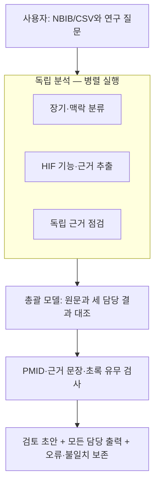

# 연구 에이전트 팀 — 브라우저에서 실행

Claude·DeepSeek·OpenAI·Gemini를 역할별로 지정하는 **로컬 실행용 첫 버전**입니다. 모델이 외부 도구를 자율 실행하는 범용 시스템이 아니라, 문헌의 독립 분석과 근거 대조를 위한 고정 워크플로입니다.



**실제 API 연결은 아직 검증하지 않았습니다.** 이 환경에는 해당 API 키가 없으며 실제 모델은 호출하지 않았습니다. API 키 없이 쓰는 시연 모드와 실제 제공자 연결 코드를 구분해서 제공합니다.

[실행 화면 미리보기](preview.png)

## Windows에서 시작하기

1. **[프로그램 ZIP 다운로드](research_agent_starter.zip)**를 엽니다. GitHub에서 **Download raw file(↓)**을 눌러 저장합니다.
2. ZIP을 마우스 오른쪽 버튼으로 눌러 **모두 압축 풀기**를 선택합니다.
3. 컴퓨터에 **Python 3.11 이상**이 없다면 [python.org의 Windows 설치 파일](https://www.python.org/downloads/windows/)을 설치합니다. 설치 화면에 `Add python.exe to PATH`가 보이면 선택합니다.
4. 압축을 푼 폴더의 **`start_windows.bat`**를 더블클릭합니다.
5. 브라우저에서 연구 에이전트 화면이 열립니다. 명령창은 실행 중 열어두세요. `pip`, Node.js, Docker 설치는 필요 없습니다.

Windows 배치 파일 자체는 이 Linux 환경에서 실행하지 못했습니다. Python 서버·브라우저 업로드·실행·결과 다운로드는 테스트했습니다.

## 먼저 무료 시연으로 확인

1. **합성 예제 3편 불러오기**를 누릅니다. 이 예제는 실제 논문이 아닙니다.
2. 실행 모드를 **시연 — 실제 모델 호출 없음**으로 둡니다. 모델 ID와 API 키는 비워도 됩니다.
3. **팀 실행**을 누릅니다.
4. **전체 결과 ZIP 저장**으로 결과 파일이 저장되는지 확인합니다.

시연 모드에서 실제 논문 파일을 업로드하면 자료 처리와 데이터 보존 흐름만 확인합니다. **실제 논문에 가짜 기능 분석을 붙이지 않습니다.**

## 실제 연구에 연결

1. **PubMed NBIB 또는 CSV** 파일을 올립니다. 기존 `HIF_PubMed_통합_10112편.csv`와 `organ_all_10112.csv`도 읽습니다. 파일은 40MB 이하입니다.
2. 역할별 제공자를 선택합니다. **그림처럼: Claude 총괄 + DeepSeek 담당** 버튼으로 그림의 기본 구성을 만들 수 있습니다. OpenAI나 Gemini를 특정 역할에 넣어 교차 검토할 수도 있습니다.
3. **API 연결 설정**을 열어 사용하는 제공자의 API 키를 입력합니다. 키를 채팅·GitHub·코드 파일에 적지 마세요. 앱은 키를 설정 파일이나 결과에 저장하지 않습니다. 입력창과 실행 중 메모리에만 두며, 종료 후에는 다시 입력합니다.
4. **사용 가능 모델 조회**를 눌러 자신의 계정에서 사용할 수 있는 모델 ID를 확인하고 각 역할의 **모델 ID**에 입력합니다. 특정 모델을 최신 모델이라고 하드코딩하지 않았습니다. 목록에 임베딩·이미지 모델이 포함될 수 있으므로 **텍스트 대화 모델**을 선택하세요.
5. 모드를 **실제 API**로 바꾸고 최대 편수를 **1~3편**으로 시작합니다. 필요하면 `placenta`, `kidney` 같은 검색어로 제목·초록에서 대상을 좁힙니다. 선택 순서는 원본 파일의 순서입니다.
6. 실제 API 전송·호출 확인란을 선택하고 **팀 실행**을 누릅니다. 한 논문에 독립 담당 3회와 총괄 1회, 최대 4회의 텍스트 모델 호출을 사용합니다. 사용량 요금은 제공자·모델·입출력/추론 토큰에 따라 달라지며 여기서 고정 가격을 계산하지 않습니다.
7. 결과 ZIP의 JSON에서 담당별 해석·총괄 결과·근거 문장을 대조합니다. 오류가 없는지 확인한 뒤 묶음을 늘리세요. 현재 한 번의 실행은 최대 20편입니다.

**ChatGPT/Claude 웹 구독과 API 사용료는 별개**입니다. 제공자 계정의 API 접근 권한과 잔액이 필요합니다. 같은 제공자의 키 하나를 여러 역할에 재사용할 수 있습니다. 사용하는 역할의 제공자 키만 필요합니다.

계정·키 관리: [Anthropic 문서](https://docs.anthropic.com/) · [DeepSeek 플랫폼](https://platform.deepseek.com/) · [OpenAI 플랫폼](https://platform.openai.com/) · [Google AI Studio](https://aistudio.google.com/apikey)

## 결과와 검증 범위

- **모든 입력 행과 원래 필드(`source_fields`)**를 JSON에 보존합니다. 같은 PMID의 중복 행도 지우지 않습니다.
- 선택하지 않은 논문은 `not_selected`이며 **분석된 것으로 표시하지 않습니다.**
- 각 담당의 원문 출력·JSON 결과, 총괄 결과, 오류·불확실성을 보존합니다. 실패 시 자동으로 다른 모델로 대체하거나 성공한 것처럼 만들지 않습니다.
- PMID, 효과 방향·동형의 형식, 근거 문장의 **전달한 초록 내 일치**, 초록 결측·철회 표시 등을 검사합니다.
- 검사 통과는 `valid_claims`라는 **문장 일치 후보**입니다. 인과성·의미의 정확성·연구 질·문헌의 일관성을 검증하지 않습니다. 다른 모델들의 동의 역시 정답의 증명이 아닙니다.
- 초록은 모델 입력에서 16,000자로 제한하며, 잘린 경우 모델 입력의 `abstract_truncated`가 표시됩니다. 전체 초록은 결과 JSON에 남깁니다.
- 키·제공자 오류 본문·전체 HTTP 요청은 기록하지 않습니다. 모델 ID·토큰 한도, 연구 질문, UTC 실행 시각과 제공자가 반환한 사용량 정보는 기록합니다.
- 전체 문헌의 장기별 **합의 요약을 자동 확정하는 단계는 아직 없습니다.** 먼저 논문별 추출과 검토를 검증하기 위한 버전입니다.

결과 상태: `not_selected` 미실행, `worker_failed` 담당 오류, `supervisor_failed` 총괄 오류, `review_needed` 검사 문제, `candidate_completed` 검토 초안 생성. 마지막 상태도 과학적 확정을 뜻하지 않습니다.

현재 작업과 키는 메모리에 있습니다. **결과를 저장한 뒤 종료**하세요. 중단 작업 자동 재개·분산 실행·장기 보관 서버는 이번 버전에 포함하지 않았습니다.

## 연결 문제 해결

- **401**: API 키, 키의 계정·권한을 확인합니다.
- **403/연결 실패**: 실행 컴퓨터의 네트워크, 제공자 접근 권한을 확인합니다. Codex 클라우드 안에서 실행한다면 별도 허용 도메인 적용이 필요할 수 있습니다.
- **404/400**: 모델 ID, 텍스트 API 지원 여부, 최대 응답 토큰을 확인합니다. OpenAI 연결은 **Chat Completions 호환 모델**을 대상으로 하며 Responses 전용 모델을 모두 지원한다고 보장하지 않습니다.
- **429**: 제공자의 요청 한도·API 잔액을 확인합니다.
- **JSON 오류/잘린 응답**: 원문 출력을 확인하고 토큰 한도를 조정하거나 다른 텍스트 모델로 소량 재실행합니다. 실패 호출에도 요금이 발생할 수 있어 자동 반복 호출하지 않습니다.
- 화면이 열리지 않으면 명령창에 표시된 주소를 브라우저에 입력합니다. 포트 충돌은 `python app.py --port 8766`으로 해결할 수 있습니다.

연결 대상은 코드에 고정되어 있습니다: `api.anthropic.com`, `api.deepseek.com`, `api.openai.com`, `generativelanguage.googleapis.com`. 사용자 지정 프록시·임의 API 주소는 이 버전에서 받지 않습니다.

## 개발·검증

```bash
cd research_agent
python app.py --no-browser
python -m unittest discover -s tests -v
```

추가 패키지는 필요 없습니다. 로컬 서버는 루프백 주소에만 바인딩하고 요청 토큰·Origin/Host 검사를 사용합니다. 정적 파일과 논문 텍스트를 코드로 실행하지 않습니다.

API 제공자 요청 형식·오류 처리는 모의 응답으로 테스트했습니다. **실제 4개 제공자의 현재 모델로 연결·성능·정확도·비용을 검증한 상태는 아닙니다.**
